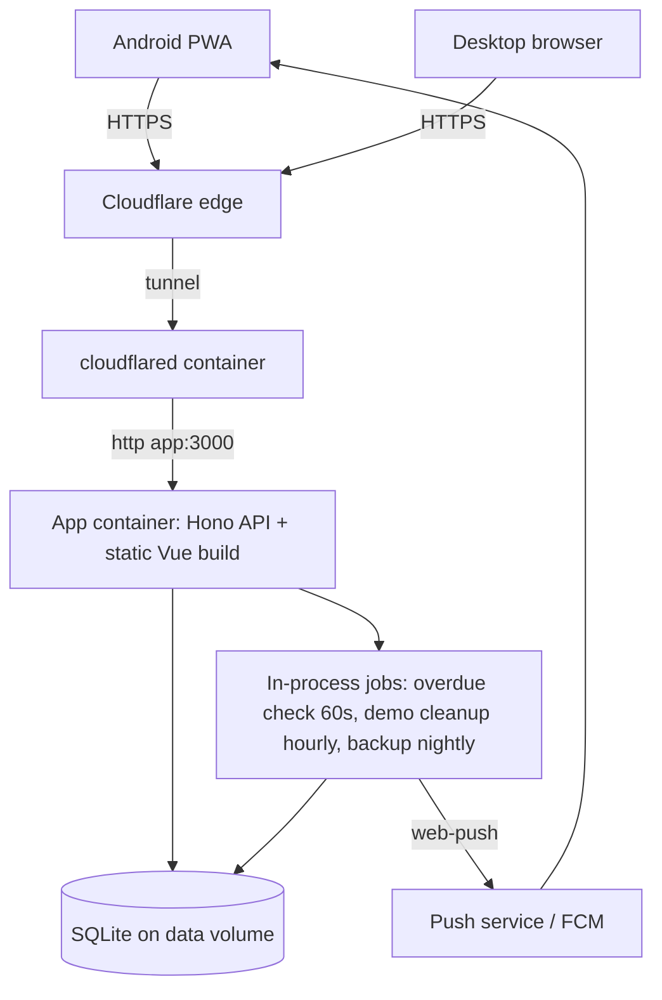
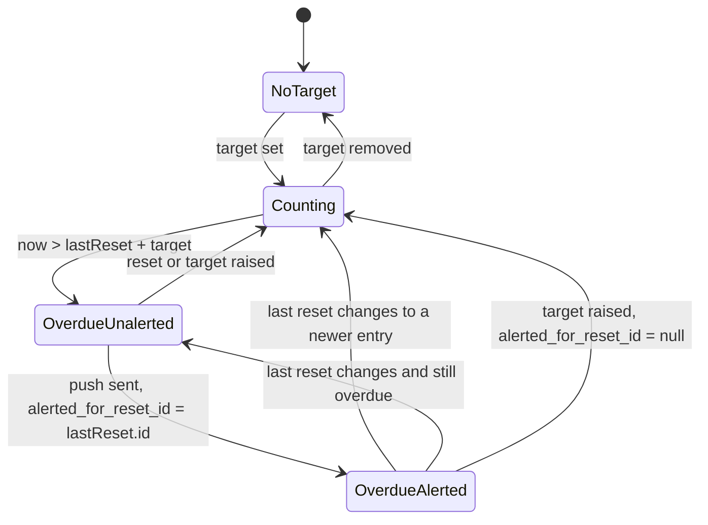

# Time Since App - Plan

## Goal Capsule

- **Objective:** A user can see at a glance how long it has been since each recurring chore last happened, on their desktop and their Android phone, and gets told when a chore is overdue.
- **Means:** One installable TypeScript web app (PWA) with a Hono + SQLite API, self-hosted in Docker on the owner's Proxmox server behind a Cloudflare Tunnel (KTD1, KTD2, KTD8).
- **Product authority:** The Product Contract below. The native Android widget is not active scope.
- **Implementation authority:** The Planning Contract. R-IDs win on product behavior; KTDs win on mechanism.
- **Stop conditions:** Stop and ask when a unit would need a product behavior that no R, AE, or KTD defines, or when a settled decision proves infeasible.
- **Execution profile:** Greenfield. Build server domain rules test-first (U2, U4, U6). Verify packaging and deployment by smoke checks (U1, U9).
- **Open blockers:** None.

---

## Product Contract

Product Contract preservation: changed: R7 — the demo is a private sandbox per visitor instead of one shared sandbox (user-directed during plan scoping), and the oldest sandbox can be removed early at the 500 cap (user-approved during document review). Changed: R5 — adds a per-user write limit and a cap of 1,000 real accounts (user-approved during document review). Changed: R15 — the creation entry cannot be deleted (user-approved during plan scoping). R16 added for the elapsed-time format.

### Summary

A "time since" app: each timer counts up from its last reset, and a tap resets it to zero. Each reset is logged with stats, and a timer with a target interval sends an Android push alert when it becomes overdue. Anyone can sign up, and a public demo lets portfolio visitors try it without an account.

### Problem Frame

The owner tracks chores such as "aquarium cleaned" that recur without a fixed schedule. Existing "days since" apps cost money or show ads. The owner also wants the app as a portfolio piece, so it must be public and presentable, not a private tool only.

### Actors

- A1. Registered user: owns a private list of timers.
- A2. Demo visitor: uses a private, temporary sandbox without an account.
- A3. Owner/operator: runs the server and the public access path.

### Key Decisions

- **One installable web app, native widget later.** One codebase covers desktop and Android, push works on Android, and the demo opens with one click. Governs R1, R2. (session-settled: user-approved — chosen over a web app plus native Android app: two codebases and an APK install for portfolio visitors)
- **Self-hosted on the owner's Proxmox server.** No third-party dependency for data. Governs R3. (session-settled: user-directed — chosen over a free cloud database tier and a home PC: owner prefers own infrastructure)
- **Public internet access.** The phone must work away from home. Governs R3. (session-settled: user-directed — chosen over home Wi-Fi only and a private Tailscale network)
- **Open sign-up plus a public demo.** Portfolio visitors can try the demo or register. Governs R4, R5, R7. (session-settled: user-directed — chosen over invite-only accounts: owner accepts open registration)
- **Email + password, no email verification, no password reset in v1.** Avoids a mail-sending service. A lost password means a new account. Governs R4. (session-settled: user-approved — chosen over verified sign-up: needs an email provider)
- **Private lists per user.** No timer sharing between users. Governs R6. (session-settled: user-approved — chosen over shared household timers)
- **Push alerts on overdue targets.** Governs R12. (session-settled: user-directed — chosen over visual-only overdue state and no targets)
- **Private demo sandbox per visitor.** Visitors cannot disturb each other. Governs R7. (session-settled: user-directed — chosen over one shared demo: a second visitor could delete what the first visitor sees)
- **Creation is the first, permanent log entry.** A timer always has a "last reset", so stats and alerts never meet an empty log. Governs R8, R15. (session-settled: user-approved — chosen over an empty log after deleting all entries: needs special empty-state rules everywhere)

### Requirements

**Platform and access**

- R1. The app runs in a desktop browser and installs on Android as a home-screen app.
- R2. All data syncs through the server, so a reset on one device shows on the other device when that device's app regains focus or reopens.
- R3. The app runs as a Docker deployment on the owner's Proxmox/Portainer host and is reachable over HTTPS on a public hostname.

**Accounts and demo**

- R4. Anyone can register with email and password and then log in on any device for 30 days without logging in again.
- R5. Rate limits on sign-up, login, demo creation, and per-user writes protect the server. Each user has a cap of 50 timers and 1,000 log entries per timer, and the server accepts at most 1,000 real accounts.
- R6. A user sees and changes only their own timers.
- R7. "Try demo" gives the visitor a private sandbox with seeded example timers and full editing, which the server deletes after 24 hours and which sends no push alerts. When 500 live sandboxes exist, the server removes the oldest one early to make room.

**Timers**

- R8. A user can create, rename, and delete a timer. A new timer starts counting from its creation time.
- R9. Each timer shows the elapsed time since its last reset, updating live while the app is open.
- R10. A one-tap reset sets the timer to now. An "Undo" option shows for 8 seconds on that device and removes that reset completely.
- R11. A user can log a reset at a past date and time (backdating) and can add a short note to any reset. Reset times in the future are rejected.
- R12. A timer can have an optional target interval. When elapsed time passes the target, the timer shows as overdue and the user's subscribed devices get one push alert for that overdue period.

**History and stats**

- R13. Each timer keeps a log of all resets, with date, time, and note.
- R14. Each timer shows simple stats from its log: average gap, longest gap, and number of resets.
- R15. A user can delete a single log entry except the creation entry. Stats and the "last reset" follow the remaining log.
- R16. Elapsed time shows as "Xd Yh" for one day or more and "Xh Ym" below one day.

### Key Flows

- F1. Reset a chore
  - **Trigger:** The user cleaned the aquarium.
  - **Actors:** A1
  - **Steps:** The user opens the app on the phone; taps reset on "Aquarium cleaned"; the timer shows 0; the desktop shows the same value when it regains focus.
  - **Covered by:** R2, R9, R10, R13
- F2. Overdue alert
  - **Trigger:** "Aquarium cleaned" has a 14-day target and reaches 14 days.
  - **Actors:** A1
  - **Steps:** The server detects the overdue timer; the user's phone gets a push alert; the user taps it and the app opens on the timer, marked overdue; a reset clears the overdue state.
  - **Covered by:** R12
- F3. Portfolio visitor
  - **Trigger:** A visitor opens the public URL.
  - **Actors:** A2
  - **Steps:** The visitor picks "Try demo"; edits and resets example timers in a private sandbox; optionally registers a real account.
  - **Covered by:** R4, R7

### Acceptance Examples

- AE1. **Covers R10, R14.** Given a timer with resets on days 1, 8, and 15, when the user resets on day 20 and taps Undo, then the last reset is day 15 and the average gap is 7 days.
- AE2. **Covers R11, R14.** Given a last reset on day 15, when the user backdates a reset to day 12, then the last reset stays day 15 and the stats include the day-12 entry.
- AE3. **Covers R11.** Given a last reset on day 15 and today is day 20, when the user backdates a reset to day 18, then the last reset becomes day 18.
- AE4. **Covers R12.** Given a 14-day target, when the timer passes 14 days, then one push alert goes out; no further alert goes out until the last reset changes and the timer becomes overdue again.
- AE5. **Covers R7.** Given two visitors in the demo, when visitor 1 deletes all timers, then visitor 2 still sees the seeded timers.
- AE6. **Covers R12, R10.** Given an alert went out for an overdue timer, when the user resets and then taps Undo, then the timer is overdue again and no second alert goes out for that same last reset.
- AE7. **Covers R14.** Given a timer with only its creation entry, then average and longest gap show "—" and the reset count is 0.

### Success Criteria

- The owner uses the app daily on both desktop and Android instead of a paid or ad-supported app.
- A portfolio visitor reaches a working demo from the public URL in one click.

### Scope Boundaries

**Deferred for later**

- Native Android home-screen widget.
- Resets made while offline that sync later.
- iPhone support testing.
- Email verification and password reset.
- Live push of changes to an open app (refresh on focus is the v1 rule, per R2).

**Outside this product's identity**

- Shared timers between users or households.
- Fixed schedules and habit streaks: the app counts time since an event, it does not plan events.

### Dependencies / Assumptions

- The owner's Proxmox host is on most of the time; when it is off, the app is unreachable.
- The public hostname is a subdomain of thummper.net, and thummper.net DNS is (or can be) managed by Cloudflare. This is required by KTD8.
- Gaps are measured in real elapsed time, so a daylight-saving change shifts one gap by one hour. This is accepted.

---

## Planning Contract

### Key Technical Decisions

- KTD1. **TypeScript full stack: Vue 3 + Vite + Tailwind front end, Hono API on `@hono/node-server`, one repository and one Node process.** Hono gives a typed RPC client to the Vue code with no codegen, plus built-in `cookie`, `csrf`, and `secureHeaders` middleware. The API serves the built front end as static files, so the app has a single origin. (session-settled: user-directed — chosen over Laravel + Vue and Rails + Vue: one language and a small container)
- KTD2. **SQLite through better-sqlite3 and Drizzle ORM.** Migrations come from `drizzle-kit generate` and apply at server start. Pragmas: `journal_mode=WAL`, `foreign_keys=ON`, `busy_timeout`. `node:sqlite` is not used: it is a release candidate and Drizzle has no official driver for it.
- KTD3. **All times are UTC epoch milliseconds.** The client converts to local time for display and backdate input. Stats use real elapsed milliseconds.
- KTD4. **"Last reset" is derived, never stored.** It is the log entry with the latest `at` for the timer. Undo, backdate, and log deletion therefore need no extra bookkeeping. Implements R10, R11, R15.
- KTD5. **Alert state is one column: `alerted_for_reset_id` on the timer.** A timer is due for an alert when it has a target, `now > lastReset.at + target`, and `alerted_for_reset_id` differs from the last reset's ID. The column takes the last reset's ID when at least one subscription accepted the send, or when every send failed permanently. It stays unset only when every send failed with a temporary error, so the next run retries (U6). A target change that makes the timer not overdue clears the column to null. Undo, backdate, and log deletion re-arm correctly with no special code. A deleted-then-restored last reset can cause a second alert for one overdue period; this is accepted. Implements R12, AE4, AE6.
- KTD6. **Hand-written cookie sessions (the Lucia v3 "from scratch" pattern).** The token is 20+ random bytes in an HttpOnly, Secure, `SameSite=Lax` cookie. The database stores only its SHA-256 hash. Sessions last 30 days with sliding renewal. Login creates a new session. Passwords use argon2id through `@node-rs/argon2`. CSRF protection is `SameSite=Lax` plus Hono's `csrf()` Origin check, bound to the `PUBLIC_ORIGIN` setting. The check never infers the origin from the request URL, because the tunnel forwards plain HTTP. Implements R4.
- KTD7. **Rate limits use `hono-rate-limiter` with its in-memory store, keyed by client IP and, for auth, by email.** The client IP comes from `CF-Connecting-IP`; other forwarded headers are ignored because clients can fake them. When that header is missing (local development and tests), the key falls back to the socket remote address. A test flag raises the limits for the e2e run. One process makes the memory store sufficient. Implements R5.
- KTD8. **Public access through a Cloudflare Tunnel.** A `cloudflared` container in the same Portainer stack routes the public hostname to the app container. It needs no open inbound ports, no dynamic DNS, and works behind carrier-grade NAT. Cloudflare terminates TLS. Implements R3.
- KTD9. **A demo sandbox is an ordinary user row with `is_demo = true`.** "Try demo" creates that user, seeds timers with times relative to now, and logs the visitor in. All user scoping therefore applies to the demo with no special paths. Demo users cannot subscribe to push or change account details. An hourly job deletes demo users older than 24 hours. A cap of 500 live demo users deletes the oldest when reached. Implements R7, AE5.
- KTD10. **Background work runs in-process.** A 60-second `setInterval` runs the overdue check (KTD5). `croner` runs the hourly demo cleanup and the nightly backup. Exactly one container replica runs.
- KTD11. **Web push through the `web-push` library with fixed VAPID keys from environment variables.** One subscription row per device endpoint (unique). Logout deletes that device's subscription. A login on a browser that already has a subscription moves it to the new user. A 404 or 410 from the push service deletes the subscription; a 401 or 403 does not. Implements R12.
- KTD12. **The service worker uses vite-plugin-pwa `injectManifest` with a custom `src/client/sw.ts`.** It precaches the app shell, handles `push`, `notificationclick`, and `pushsubscriptionchange`, and never caches `/api/*`. `registerType: 'prompt'` shows an "Update available" toast. Implements R1, R12.
- KTD13. **Client data refreshes on focus and on visibility change; writes are last-write-wins.** A write to a deleted timer gets 404, and the client removes the timer. Implements R2.
- KTD14. **Backups use `VACUUM INTO` nightly into a second folder on the data volume, keeping the newest 14 copies.** The live database file is never copied while WAL is active.

### High-Level Technical Design

Runtime topology:



Data model:

```mermaid
erDiagram
  users ||--o{ sessions : has
  users ||--o{ timers : owns
  users ||--o{ push_subscriptions : has
  timers ||--o{ resets : logs
  users { id int; email text; password_hash text; is_demo bool; created_at int }
  sessions { id_hash text; user_id int; expires_at int }
  timers { id int; user_id int; name text; target_ms int_nullable; alerted_for_reset_id int_nullable; created_at int }
  resets { id int; timer_id int; at int; note text_nullable; is_origin bool; created_at int }
  push_subscriptions { endpoint text; user_id int; p256dh text; auth text; created_at int }
```

Overdue alert state per timer (KTD5):



### Output Structure

```text
time-since/
  package.json
  vite.config.ts
  drizzle.config.ts
  Dockerfile
  docker-compose.yml
  .env.example
  README.md
  src/
    shared/            types and pure domain rules (stats, format, overdue)
    server/
      index.ts         process entry: migrate, start jobs, serve
      app.ts           Hono app and route mounting
      db/              schema, client, migrations/
      auth/            sessions, passwords, routes
      timers/          timer and reset routes and service
      demo/            seed and sandbox lifecycle
      push/            subscriptions, sender, overdue job
      jobs/            scheduler, backup
    client/
      main.ts, App.vue, router.ts, sw.ts
      api/             typed Hono client wrapper
      stores/          Pinia stores
      views/           Welcome, Login, Register, TimerList, TimerDetail, Settings
      components/      TimerCard, ResetDialog, UndoToast, StatsPanel
  tests/
    server/            Vitest API and domain tests
    client/            Vitest + Vue Test Utils component tests
    e2e/               Playwright smoke flow
```

### Sequencing

U1 → U2 → U3 → U4 → (U5, U6 in either order) → U7 → U8 → U9. U5 and U6 depend only on U3 and U4.

---

## Implementation Units

### U1. Project scaffold and tooling

**Goal:** One repository that builds the Vue client and the Node server and runs tests, type checks, and lint.

**Requirements:** R1, R3 (foundation). KTD1.

**Dependencies:** None.

**Files:**
- `package.json`, `tsconfig.json`, `tsconfig.server.json`
- `vite.config.ts`, `tailwind.config.ts`, `postcss.config.js`
- `vitest.config.ts`, `playwright.config.ts`
- `eslint.config.js`, `.prettierrc`, `.gitignore`, `.env.example`
- `src/client/main.ts`, `src/client/App.vue`
- `src/server/index.ts`, `src/server/app.ts`
- `tests/server/health.test.ts`

**Approach:**
1. Use npm, one `package.json`, Node 24 LTS.
2. Vite builds the client into `dist/client`; `tsc` or `tsup` builds the server into `dist/server`.
3. In development, Vite proxies `/api` to the Hono server.
4. Hono serves `dist/client` as static files in production and exposes `GET /api/health`. A non-`/api` GET that matches no static file returns `dist/client/index.html`, so the Vue router handles deep links and reloads.
5. `.env.example` lists `DATABASE_PATH`, `VAPID_PUBLIC_KEY`, `VAPID_PRIVATE_KEY`, `VAPID_SUBJECT`, `PUBLIC_ORIGIN`, `BACKUP_DIR`.

**Patterns to follow:** `mycotrack_frontend` (Vue 3 + Vite + Tailwind + Pinia) in the owner's other repository, for client conventions.

**Execution note:** Mostly config. Prove it with a health-check test and a working `npm run build`.

**Test scenarios:**
- `GET /api/health` returns 200 with `{ ok: true }`.
- A GET of a timer detail path returns the app shell with status 200.
- A GET of an unknown `/api` path returns 404, not the app shell.

**Verification:** `npm run build`, `npm run typecheck`, `npm run lint`, and `npm test` all pass on the empty app.

### U2. Database schema and domain rules

**Goal:** The SQLite schema, migrations, and pure functions for stats, elapsed-time format, and overdue checks.

**Requirements:** R13, R14, R16, R12 (rule only). KTD2, KTD3, KTD4, KTD5. AE1, AE2, AE3, AE7.

**Dependencies:** U1.

**Files:**
- `drizzle.config.ts`
- `src/server/db/schema.ts`, `src/server/db/client.ts`, `src/server/db/migrations/`
- `src/shared/stats.ts`, `src/shared/format.ts`, `src/shared/overdue.ts`
- `tests/server/stats.test.ts`, `tests/server/format.test.ts`, `tests/server/overdue.test.ts`, `tests/server/db.test.ts`

**Approach:**
1. Define the tables in the data model diagram. `resets.timer_id`, `timers.user_id`, `sessions.user_id`, and `push_subscriptions.user_id` cascade on delete. `resets.id` uses AUTOINCREMENT, so a deleted reset ID is never reused (KTD5 depends on this). Index `resets(timer_id, at)`.
2. The DB client sets the KTD2 pragmas and runs migrations at start. It resolves the migrations folder relative to the app root, so the same path works in development and in the built image.
3. `stats(entries)` sorts by `at`, computes gaps between neighbors, and returns average, longest, and a count that excludes the origin entry.
4. `formatElapsed(ms)` implements R16.
5. `isDueForAlert(timer, lastReset, now)` implements KTD5 as a pure function.

**Execution note:** Write the domain tests first; these rules carry most of the product behavior.

**Test scenarios:**
- Covers AE1. Entries at days 1, 8, 15 give an average gap of 7 days and a longest gap of 7 days.
- Covers AE2. Adding a day-12 entry to days 1, 8, 15 keeps last = day 15 and gives gaps 7, 4, 3.
- Covers AE7. Only an origin entry gives average "—", longest "—", count 0.
- Two entries with equal `at` give a gap of 0 and no error.
- `formatElapsed` returns "0h 0m" for 0, "23h 59m" just below one day, "1d 0h" at exactly one day, "45d 3h" for a long gap.
- `isDueForAlert` is false with no target, false before the target passes, true just after it passes, false when `alerted_for_reset_id` equals the last reset ID, and true again when the last reset ID changes and the timer is still overdue.
- Migrations apply to a fresh in-memory database, and deleting a timer cascades to its resets.
- Deleting a user removes its sessions, push subscriptions, timers, and resets.
- After the highest reset is deleted, the next inserted reset gets a new, higher ID.

**Verification:** All domain tests pass, and a fresh database file gets the full schema at server start.

### U3. Accounts and sessions

**Goal:** Sign-up, login, logout, session middleware, CSRF, and rate limits.

**Requirements:** R4, R5, R6. KTD6, KTD7.

**Dependencies:** U2.

**Files:**
- `src/server/auth/sessions.ts`, `src/server/auth/passwords.ts`, `src/server/auth/routes.ts`, `src/server/auth/middleware.ts`
- `src/server/security/rateLimit.ts`, `src/server/security/clientIp.ts`
- `tests/server/auth.test.ts`, `tests/server/rateLimit.test.ts`

**Approach:**
1. `POST /api/auth/register`, `POST /api/auth/login`, `POST /api/auth/logout`, `GET /api/auth/me`. Logout accepts an optional push endpoint and deletes that subscription for the current user (KTD11).
2. Email is trimmed and lowercased; it must look like an email. The password needs at least 8 characters.
3. Register and login answer with the same generic error for a wrong email or a wrong password.
4. The middleware resolves the session cookie into `c.var.user` and renews the expiry when less than 15 days remain.
5. Apply `csrf({ origin: PUBLIC_ORIGIN })` and `secureHeaders()` to all `/api/*` routes. In development, `PUBLIC_ORIGIN` is the Vite dev-server origin. Set cookies with `{ append: true }` because Hono can drop a cookie otherwise.
6. Rate limits: 5 registrations per IP per hour; 10 login attempts per IP and per email per 15 minutes.
7. When 1,000 real (non-demo) accounts exist, register returns 403 with a "Registration is full" message.

**Test scenarios:**
- Register with a new email creates the user, sets a session cookie, and `GET /api/auth/me` returns the email.
- Register with an existing email (any letter case) returns 409.
- Login with a correct password sets a new session ID different from any earlier session.
- Login with a wrong password and with an unknown email return the same 401 body.
- Logout deletes the session row, and the old cookie then gets 401 on `GET /api/auth/me`.
- An expired session gets 401; a session with 10 days left is renewed to 30 days.
- A bodyless or form-encoded POST with a foreign `Origin` header gets 403.
- A POST whose `Origin` equals `PUBLIC_ORIGIN`, sent to a plain-HTTP request URL, is accepted.
- The 11th login attempt within 15 minutes from one IP gets 429.
- With 1,000 real accounts, register returns 403; demo users do not count toward the cap.
- `X-Forwarded-For` does not change the rate-limit key; `CF-Connecting-IP` does.
- With no `CF-Connecting-IP` header, the rate-limit key is the socket remote address.
- Logout with a push endpoint deletes that subscription.
- The database stores the SHA-256 hash, never the raw session token.

**Verification:** Auth tests pass, and the cookie has HttpOnly, Secure, and SameSite=Lax in a production build.

### U4. Timers and reset log API

**Goal:** All timer and log operations, scoped to the logged-in user, with caps.

**Requirements:** R6, R8, R10, R11, R12 (target field), R13, R14, R15, R5 (caps). KTD4, KTD5, KTD13. AE1, AE2, AE3, AE6.

**Dependencies:** U3.

**Files:**
- `src/server/timers/routes.ts`, `src/server/timers/service.ts`, `src/server/timers/validation.ts`
- `tests/server/timers.test.ts`, `tests/server/resets.test.ts`

**Approach:**
1. Routes: list timers with last reset, elapsed, overdue flag, and stats; create; rename and set or clear the target; delete; get the log; add a reset (`at` optional, default now; `note` optional); edit a log entry's note; delete a log entry.
2. Creating a timer also inserts the origin reset (`is_origin = true`, `at = created_at`) in the same transaction.
3. "Undo" on the client calls delete-log-entry with the ID returned by the reset call. Deleting an entry that no longer exists returns 204, so a late Undo is harmless.
4. Reject a reset `at` later than server now plus 60 seconds with 422. Notes are at most 280 characters. Names are 1-60 characters. Targets are between 1 hour and 365 days.
5. Deleting the origin entry returns 422.
6. Every query filters by `c.var.user.id`; a timer of another user returns 404, not 403.
7. Caps: the 51st timer and the 1,001st log entry return 422 with a clear message.
8. A per-user rate limit allows 60 timer and reset writes per minute; the 61st returns 429.

**Execution note:** Start with failing API tests for the AEs.

**Test scenarios:**
- Create a timer: the list shows it with elapsed near 0 and a log with one origin entry.
- Covers AE1. Resets on days 1, 8, 15, then a reset on day 20 and a delete of that reset ID, give last reset day 15 and average 7 days.
- Covers AE2. A backdated reset on day 12 leaves the last reset at day 15.
- Covers AE3. A backdated reset on day 18 when now is day 20 becomes the last reset.
- A reset with `at` two minutes in the future returns 422.
- A note longer than 280 characters returns 422.
- Deleting the origin entry returns 422; deleting another entry updates stats.
- Deleting an already-deleted entry returns 204.
- Covers AE6. With `alerted_for_reset_id` set to the last reset, a reset plus delete of that reset leaves the alert column unchanged and the timer not due for a second alert.
- User B gets 404 on every route for user A's timer.
- Deleting a timer removes its log entries.
- The 51st timer returns 422 and the timer is not created.
- Editing the note of an existing entry, including the origin entry, updates it; a note over 280 characters returns 422.
- The 61st write within one minute from one user returns 429.
- Setting a target below the elapsed time marks the timer overdue in the list.
- Raising the target of an alerted timer so it is no longer overdue sets `alerted_for_reset_id` to null.

**Verification:** API tests pass, including every cross-user check.

### U5. Demo sandboxes

**Goal:** "Try demo" creates a private seeded sandbox; a daily job removes old sandboxes.

**Requirements:** R7. KTD9, KTD10. AE5. F3.

**Dependencies:** U3, U4.

**Files:**
- `src/server/demo/seed.ts`, `src/server/demo/routes.ts`, `src/server/demo/cleanup.ts`
- `tests/server/demo.test.ts`

**Approach:**
1. `POST /api/demo` creates an `is_demo` user with no password and a random placeholder email, seeds 5-6 example timers (for example "Aquarium cleaned", "Bedsheets changed", "Car washed") with backdated resets relative to now, one of them overdue, and logs the visitor in.
2. Rate limit: 10 demo creations per IP per hour.
3. Push-subscribe and account routes return 403 for demo users.
4. The cleanup deletes demo users with `created_at` older than 24 hours, every hour and at server start, so no sandbox lives past 25 hours.
5. When 500 live demo users exist, creating one deletes the oldest first.
6. A request with a session whose demo user was deleted gets 401; the client shows "Demo expired" and offers a new demo (U7).

**Test scenarios:**
- Covers AE5. Two demo sessions: deleting all timers in one leaves the other's seeded timers intact.
- A demo user's seeded data includes one overdue timer and logs with at least three entries.
- A demo user gets 403 on push subscribe.
- Cleanup deletes a demo user created 25 hours ago with its timers and sessions, and keeps one created 1 hour ago and all non-demo users.
- At 500 demo users, a new demo deletes the oldest one.

**Verification:** Demo tests pass, and a fresh demo looks realistic in the UI.

### U6. Push subscriptions and overdue alerts

**Goal:** Devices subscribe to push; the server sends one alert per overdue period.

**Requirements:** R12. KTD5, KTD10, KTD11. AE4, AE6. F2.

**Dependencies:** U3, U4.

**Files:**
- `src/server/push/routes.ts`, `src/server/push/sender.ts`, `src/server/push/overdueJob.ts`
- `src/server/jobs/scheduler.ts`
- `tests/server/push.test.ts`, `tests/server/overdueJob.test.ts`

**Approach:**
1. `GET /api/push/key` returns the VAPID public key. `POST /api/push/subscribe` upserts by endpoint and sets the current user. `POST /api/push/unsubscribe` deletes by endpoint. `POST /api/push/resubscribe` replaces an old endpoint with a new one (from `pushsubscriptionchange`).
2. Logout (U3) also deletes the subscription whose endpoint the client sends with the logout request.
3. The overdue job selects non-demo timers that are due per `isDueForAlert`, sends to every subscription of the owner, and then sets `alerted_for_reset_id`. A timer whose owner has no subscription still gets the column set, so a later subscription does not flood old alerts.
4. Payload: timer name, elapsed text, and the timer URL. `TTL` 24 hours, `urgency: 'high'`.
5. A 404 or 410 deletes the subscription. Network errors, 429, and 5xx are temporary; other 4xx errors are permanent and are logged.
6. When at least one subscription accepted the send, the job sets `alerted_for_reset_id`, so a device that got the alert never gets it again. When every send failed with a temporary error, the job leaves the column unset and retries on later runs until 6 hours after the timer became overdue, then sets it. When every send failed permanently, the job sets the column, so one bad device cannot cause repeated sends.
7. The sender is an injectable interface so tests do not call the network.

**Test scenarios:**
- Covers AE4. A timer that passes its target triggers one send; a second job run sends nothing.
- Covers AE6. After an alert, a reset and an undo leave the timer overdue and the next job run sends nothing.
- A reset after an alert, then the timer becoming overdue again, triggers a new send.
- A user with two subscriptions gets two sends for one timer.
- A 410 response deletes that subscription; a 401 response keeps it.
- A 503 response leaves the alert unsent, and the next run retries and sends.
- With two subscriptions, a 201 plus a 503 sends once, and the next run sends nothing.
- After an alert, raising the target clears the alert marker; when the timer then passes the new target, one new alert goes out.
- A timer overdue for more than 6 hours whose sends keep failing with 503 gets marked as alerted and stops retrying.
- Subscribing an endpoint already owned by user A while logged in as user B moves it to user B.
- A timer with no target is never sent.
- A demo user's overdue timer is never sent.

**Verification:** Push tests pass with a fake sender; one manual send reaches a real Android phone (U9).

### U7. Client app: accounts and timers

**Goal:** The Vue screens for login, register, demo entry, the timer list, and the timer detail with log and stats.

**Requirements:** R2, R4, R7, R8, R9, R10, R11, R12 (overdue display), R13, R14, R15, R16. KTD13. F1, F3.

**Dependencies:** U4, U5.

**Files:**
- `src/client/router.ts`, `src/client/api/client.ts`
- `src/client/stores/auth.ts`, `src/client/stores/timers.ts`
- `src/client/views/Welcome.vue`, `src/client/views/Login.vue`, `src/client/views/Register.vue`, `src/client/views/TimerList.vue`, `src/client/views/TimerDetail.vue`, `src/client/views/Settings.vue`
- `src/client/components/TimerCard.vue`, `src/client/components/ResetDialog.vue`, `src/client/components/UndoToast.vue`, `src/client/components/StatsPanel.vue`, `src/client/components/TimerForm.vue`, `src/client/components/DemoBanner.vue`
- `tests/client/TimerCard.test.ts`, `tests/client/UndoToast.test.ts`, `tests/client/ResetDialog.test.ts`, `tests/client/timersStore.test.ts`, `tests/client/TimerList.test.ts`, `tests/client/Settings.test.ts`

**Approach:**
1. The welcome page offers "Try demo", "Log in", and "Sign up". Logged-in users go straight to the list.
2. The list shows one card per timer: name, elapsed (R16), a reset button, and the target when set. An overdue card shows an "Overdue by X" label (R16 format) with an icon, plus a color change. Sort overdue timers first, then by elapsed descending. After a reset, the card keeps its position with a short "Reset" state until its undo toast closes or the next focus refresh, then the list re-sorts.
3. A persistent "Add timer" button on the list opens `TimerForm`: a name and an optional target, entered as a number plus a days/hours unit selector.
4. A one-second ticker updates elapsed values locally; the server values refresh on focus and visibility change (KTD13).
5. A reset shows `UndoToast` for 8 seconds; Undo deletes that reset ID. The toast is announced through an `aria-live` region and is reachable by keyboard.
6. A visible menu button on each card opens `ResetDialog` for backdate (local date and time, max = now) and a note. A long press on the reset button is a shortcut to the same dialog. The reset button's touch target is at least 44 px.
7. Interaction states: an empty list shows a short message and a prominent "Add timer" action; the first fetch shows a loading state; a failed reset or fetch shows an inline error with a retry, and the timer keeps its old value; cap (422) and rate-limit (429) responses on sign-up, login, demo, and create show a plain-language message.
8. A Settings view, one tap from the list header, holds the account email, `NotificationToggle` (U8, hidden for demo users), and a "Log out" action. For a demo session, Settings hides the email and shows "Leave demo" instead of "Log out", with a warning that the sandbox cannot be reopened.
9. The detail view shows a loading state, then stats, the log (newest first) with an edit-note action per entry and a delete action per entry (hidden for the origin entry), and rename, target, and delete-timer actions.
10. Delete-timer asks for confirmation and shows the reset count.
11. A 404 on a timer removes it from the store; on the detail view it shows "Timer no longer exists" with a link back to the list. A fetch error on the detail view shows an inline retry. A 401 sends the user to the welcome page; for a demo session it shows "Demo expired". After a login that started from a deep link, the app returns to that URL.
12. The demo shows `DemoBanner`, which says the sandbox is temporary and ends within 24 hours, with a "Create a real account" link.
13. Layout works from 360 px phone width to desktop.

**Test scenarios:**
- `TimerCard` shows "3d 4h" for an elapsed time of 3 days 4 hours and the overdue style when the timer is overdue.
- `UndoToast` calls the delete with the reset ID when tapped and disappears after 8 seconds without a call.
- `ResetDialog` blocks a date and time later than now.
- The timers store refetches when the window regains focus.
- The timers store removes a timer when an update returns 404.
- The detail view hides the delete action for the origin entry.
- `TimerCard` shows "Overdue by 2d 3h" as text, not only as color, for a timer 2 days 3 hours past its target.
- `UndoToast` renders inside an `aria-live` region and its Undo button takes keyboard focus.
- The timer list with zero timers shows the empty message and the "Add timer" action.
- A failed reset shows an inline error with retry, and the card keeps its previous elapsed value.
- `TimerForm` converts "3 days" to a target of 3 days in milliseconds.
- The detail view for a deleted timer shows "Timer no longer exists" and a link to the list.
- After a reset, the card stays in its list position until its undo toast closes, then moves to its sorted position.
- The detail view's edit-note action saves a new note on an existing entry.
- For a demo session, Settings shows "Leave demo" and no email.
- A logged-out user who opens a timer URL returns to that timer after login.
- Settings opens from the list in one tap, shows the logout action, and hides `NotificationToggle` for a demo user.

**Verification:** Component tests pass, and the Playwright smoke flow (U9) covers register, create, reset, undo.

### U8. PWA install, service worker, and push opt-in

**Goal:** The app installs on Android, updates with a prompt, and receives push alerts.

**Requirements:** R1, R12. KTD11, KTD12. F2.

**Dependencies:** U6, U7.

**Files:**
- `vite.config.ts` (PWA plugin)
- `src/client/sw.ts`
- `src/client/push/subscribe.ts`
- `src/client/components/NotificationToggle.vue`, `src/client/components/UpdatePrompt.vue`
- `public/icons/` (192 and 512 px icons, maskable variant)
- `tests/client/subscribe.test.ts`

**Approach:**
1. Manifest: name "Time Since", `display: standalone`, theme colors, icons.
2. `sw.ts`: precache the shell; `push` shows a notification with the timer name and elapsed text; `notificationclick` focuses an open window or opens the timer URL; `pushsubscriptionchange` calls the resubscribe route.
3. `/api/*` is network-only. A navigation route serves the precached `index.html` for app paths, with `/api/*` on its denylist.
4. `NotificationToggle` in the Settings view (U7) asks for permission only from a user tap, then subscribes with the VAPID key from `GET /api/push/key`. It is hidden for demo users.
5. Logout sends the current endpoint, then unsubscribes in the browser.
6. `UpdatePrompt` uses `useRegisterSW` to show "Update available — reload".

**Execution note:** Verify on a real Android device; the service worker cannot be fully proven in unit tests.

**Test scenarios:**
- `subscribe` posts the endpoint and keys to the server after permission is granted.
- `subscribe` does nothing and shows a hint when permission is denied.
- `NotificationToggle` is not rendered for a demo user.

**Verification:** Lighthouse reports the app as installable; Chrome on Android installs it; a push sent from the server shows a notification that opens the right timer.

### U9. Docker deployment, tunnel, backups, and runbook

**Goal:** One Portainer stack runs the app and the tunnel on the Proxmox host, with nightly backups.

**Requirements:** R3. KTD8, KTD10, KTD14. Success Criteria.

**Dependencies:** U1-U8.

**Files:**
- `Dockerfile`, `.dockerignore`
- `docker-compose.yml`
- `src/server/jobs/backup.ts`
- `tests/server/backup.test.ts`
- `tests/e2e/smoke.spec.ts`
- `README.md`

**Approach:**
1. Multi-stage Dockerfile on `node:24-bookworm-slim`: build stage compiles better-sqlite3 and the app; runtime stage copies `dist/` and `src/server/db/migrations/` and runs as a non-root user.
2. Compose: service `app` (port 3000 inside the network only, volume `data:/data`, env from the stack) and service `cloudflared` (`tunnel run` with `TUNNEL_TOKEN`). One replica.
3. The backup job runs `VACUUM INTO` at 02:30 into `/data/backups/` and keeps the newest 14 files.
4. README runbook: generate VAPID keys once, create the Cloudflare Tunnel and public hostname, set stack env vars in Portainer, deploy, restore from a backup.
5. Playwright smoke: welcome → sign up → create timer → reset → undo → try demo.

**Execution note:** Packaging work; prove it by building the image and running the smoke test against the container.

**Test scenarios:**
- The backup job writes a readable SQLite file and deletes the oldest when 15 exist.
- Playwright smoke flow passes against the running container.

**Verification:** The image builds; the stack starts in Portainer; the public hostname serves the app over HTTPS; the Android phone installs it and receives a test alert.

---

## Verification Contract

| Gate | Command | Applies to |
|---|---|---|
| Unit and API tests | `npm test` | U1-U9 |
| Type check | `npm run typecheck` | All |
| Lint | `npm run lint` | All |
| Production build | `npm run build` | U1, U7, U8, U9 |
| End-to-end smoke | `npm run test:e2e` | U7, U9 |
| Container build | `docker build .` | U9 |

Manual checks that tests cannot prove: install on Android Chrome, receive a real push, open the public hostname from mobile data.

## Definition of Done

- Every R1-R16 is implemented and traced to a passing test or a manual check above.
- AE1-AE7 each have a passing test.
- All gates in the Verification Contract pass.
- The stack runs on the Proxmox host, reachable on the public hostname, and the owner's phone has received one real overdue alert.
- The README runbook lets the owner redeploy and restore from a backup without this plan.
- No dead code, experimental code, or unused dependencies from abandoned attempts remain.

## Sources / Research

- vite-plugin-pwa `injectManifest`: https://vite-pwa-org.netlify.app/guide/inject-manifest.html
- Web push 410 handling: https://pushpad.xyz/blog/web-push-error-410-the-push-subscription-has-expired-or-the-user-has-unsubscribed
- Lucia v3 session pattern (from scratch): https://lucia-auth.com/lucia-v3/migrate
- Drizzle with SQLite: https://orm.drizzle.team/docs/quick-sqlite
- `node:sqlite` status: https://nodejs.org/api/sqlite.html
- Cloudflare Tunnel with Docker: https://dev.to/mihailtd/secure-self-hosting-with-cloudflare-tunnels-and-docker-zero-trust-security-5bbn
- Hosted demo pattern: https://github.com/brettinternet/docker-compose-hosted-demo
