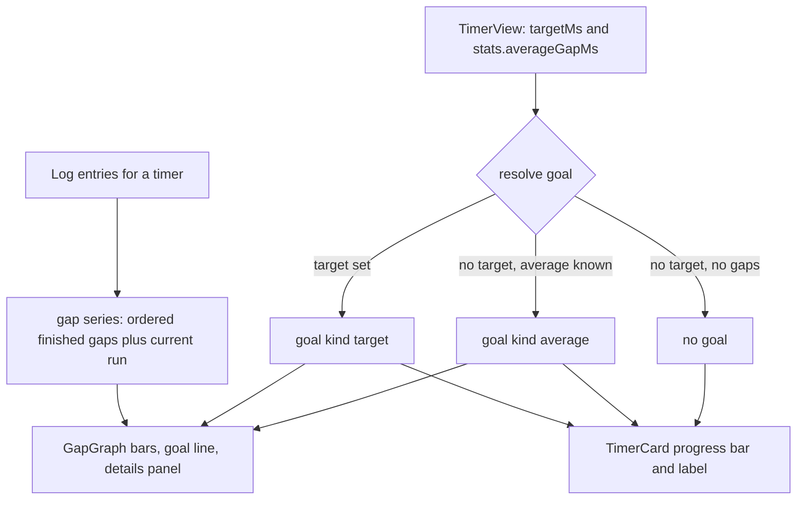

# Gap Graph and Card Progress - Plan

## Goal Capsule

- **Objective:** A user can see at a glance how the current run compares to their goal, and can see on the detail page whether their gaps between resets get longer or shorter over time.
- **Means:** One shared gap-and-goal module feeds the existing card progress bar and a new hand-built bar graph on the detail page (KTD1, KTD2).
- **Product authority:** This Product Contract. The base app plan `docs/plans/2026-10-14-1946-feat-time-since-app-plan.md` stays authoritative for everything this plan does not change.
- **Open blockers:** None.
- **Stop conditions:** Stop and report when a requirement needs a server or schema change, or a new runtime dependency. The plan expects neither.
- **Execution profile:** Client and shared code only. Four units, U1 first, then U2 and U3 in any order, then U4.
- **Product Contract preservation:** Restructured, no scope change: the Summary now names the no-goal case per R3, AE5 says "scrolling back" instead of a swipe direction, and AE6 names the inline details panel instead of a popup.

---

## Product Contract

### Summary

Every timer card with a goal shows a progress bar for the current run: toward the target, or toward the average gap when the timer has no target. The timer detail page gets a bar graph of past gaps with a goal line, a bar for the current run, and tap-for-details on each bar.

### Problem Frame

The app logs every reset, but today the only history view is a list of dates plus three numbers (average gap, longest gap, reset count). A user cannot see a trend: whether the gaps grow, shrink, or stay flat. The card already shows a progress bar toward the target, but a timer without a target shows nothing about how this run compares to the user's normal rhythm.

### Key Decisions

- **The card answers "how close am I?"; the detail page answers "am I getting better?"** The card gets a progress bar, not a sparkline, so the list stays calm and readable. Governs R1, R6. (session-settled: user-directed — chosen over a sparkline on each card and a detail-only graph: the card should show progress, the trend belongs on the detail page)
- **The average gap is the goal when a timer has no target.** A full bar means "longer than usual", not "beat your record". Governs R2, R8. (session-settled: user-directed — chosen over the longest gap and hiding the bar)
- **Past the goal, the bar stays full, changes color, and a label says how far past.** Governs R4. (session-settled: user-approved — chosen over a growing scale and a full bar with no extra signal)
- **Passing the average uses a calm color; only passing a target uses the overdue color.** About half of all runs pass the average, so an alarm color there would nag. Governs R4, R5. (session-settled: user-approved — proposed in the scope synthesis and confirmed)
- **The detail graph shows the 30 newest gaps and scrolls back for older ones.** Governs R9. (session-settled: user-directed — chosen over squeezing all gaps into view and a time-range picker)
- **Tapping a bar shows that gap's details.** Governs R11. (session-settled: user-directed — chosen over jumping to the log entry and a view-only graph)
- **Extend the existing card bar instead of adding a second one.** The card already shows a target progress bar with "Due in" and "Overdue by" labels; this work widens it to timers without a target and adds the past-goal color.

### Requirements

**Card progress bar**

- R1. Every timer card shows one progress bar for the current run, measured against the timer's goal.
- R2. The goal is the target when the timer has one; otherwise it is the timer's average gap.
- R3. A timer with no target and no finished gap yet (only the creation entry) shows no bar.
- R4. When the current run passes the goal, the bar stays full, changes color, and a label states how far past the goal the run is.
- R5. The past-goal color for a target is the existing overdue treatment; the past-goal color for an average is a calm, non-alarm color.
- R6. Before the goal, the label states the time left to the goal, as the card does for targets today.
- R7. The label makes clear whether the goal is the target or the average, so the user can tell the two apart.
- R8. The average follows the log: backdating, deleting, or adding a reset updates the bar on the next refresh.

**Detail gap graph**

- R9. The timer detail page shows a bar graph with one bar per finished gap, oldest on the left and newest on the right, showing the 30 newest gaps first; the user can scroll or swipe back to older gaps.
- R10. The graph ends with a distinct bar for the current, unfinished run and draws a goal line at the same goal the card uses (per R2).
- R11. Tapping a bar shows its start date, end date, gap length, and the note of the reset that ended it; the current-run bar shows its start date and length so far.
- R12. A timer with no finished gap shows the current-run bar only, with a short line saying the graph fills in after the first reset.
- R13. The graph works at phone width and in both light and dark themes, and has a text alternative for screen readers.

### Acceptance Examples

- AE1. **Covers R2, R6, R7.** Given a timer with no target and finished gaps of 3, 5, and 4 days, when the current run is 2 days, then the card bar is half full and the label says 2 days left to the average.
- AE2. **Covers R4, R5.** Given a timer with a 14-day target, when the current run is 17 days, then the bar is full in the overdue color and the label says 3 days past the target.
- AE3. **Covers R4, R5.** Given a timer with no target and a 4-day average, when the current run is 6 days, then the bar is full in the calm color and the label says 2 days past the average.
- AE4. **Covers R3, R12.** Given a new timer with no target and no resets, then the card shows no bar, and the detail graph shows only the current-run bar with the fill-in message.
- AE5. **Covers R9.** Given a timer with 45 finished gaps, when the detail page opens, then the graph shows the 30 newest gaps, and scrolling back reveals the older 15.
- AE6. **Covers R11.** Given a gap that ended with a reset noted "work trip", when the user taps that bar, then the details panel under the graph shows both dates, the gap length, and "work trip".

### Scope Boundaries

- A calendar heatmap or any view of which days or weekdays resets fall on.
- A time-range picker (30 days, 90 days, 1 year).
- Graphs that compare several timers.
- A graph on the timer card itself, beyond the progress bar.
- Editing or deleting a reset from the graph; the log list stays the place for that.

### Dependencies / Assumptions

- The gap data already exists: each log entry has a time and an optional note (`src/server/db/schema.ts`), and the shared stats code already computes gaps between neighboring entries (`src/shared/stats.ts`).
- The average used as a goal is the same average the stats panel shows today: finished gaps only, the current run excluded.

### Sources / Research

- `src/client/components/TimerCard.vue` — the existing target progress bar, "Due in" and "Overdue by" labels, and the overdue outline.
- `src/client/components/StatsPanel.vue` and `src/client/views/TimerDetail.vue` — where the detail graph sits next to the stats and the log.
- `src/shared/stats.ts` — gap and average computation.

---

## Planning Contract

### Key Technical Decisions

- KTD1. **A hand-built graph in a Vue component, no chart library.** The graph is one bar series, one line, and a tap target per bar. A library adds bundle weight to a PWA and fights the CSS theme tokens. Plain markup reads the tokens in `src/client/style.css` directly, so light and dark themes work without extra work. KTD8 sets the markup.
- KTD2. **One pure shared module owns gaps and goals.** Add `src/shared/gaps.ts` next to `src/shared/stats.ts`. It turns a log into an ordered gap series and resolves the goal for a timer. The card, the graph, and the tests all use it, so R2 has one implementation.
- KTD3. **No server change.** The list response already carries `stats.averageGapMs` per timer, so the card resolves its goal from `TimerView` alone. The detail page already loads the full log into `timers.logs`, so the graph builds the series on the client.
- KTD4. **A gap belongs to the reset that ends it.** The series sorts the log by `at`, then by `id`, which is the tie rule of `lastReset` in `src/shared/stats.ts`. Each neighbor pair is one finished gap. The gap's note is the note of the later entry. This matches how `stats()` computes gaps, so the graph and the stats panel always agree.
- KTD5. **One y-scale for the whole history.** The scale maximum is the largest of all gaps, the current run, and the goal. Scrolling back never rescales the bars, so the trend stays honest.
- KTD6. **Bars are native buttons; the details panel is inline, not a modal.** Each slot is an HTML `<button>` that spans the full graph height, with the bar drawn inside it. So the hit area is the whole column, not the drawn bar, and Enter and Space work without extra handlers. A drawn bar has a minimum visible height of 2px, so a zero-length gap stays visible. Each button has an `aria-label` that states its dates and length. Tapping a bar opens a small details panel under the graph and gives the selected bar a stronger outline. A tap on another bar changes it, and a second tap on the same bar closes it. When the selected gap leaves the series (for example, its entry is deleted), the panel closes.
- KTD7. **The graph scrolls inside its own box and opens at the newest end.** Each slot is one thirty-first of the box width at every series length: 30 gaps plus the current run, per R9. The slot width is set as an inline style so tests can check it without layout. A short series sits right-aligned, so the current run is always at the right edge. Older gaps sit off the left edge. On mount, and when the series length grows, the box scrolls to the right end, unless a bar is selected.
- KTD8. **Plain HTML columns for bars, inline SVG only for the goal line.** This refines KTD1: bars are flex columns of buttons (KTD6), and an absolutely positioned line marks the goal. No chart library is used.
- KTD9. **The past-target bar fill is the `--danger` token.** R5's "existing overdue treatment" is the "Overdue by" label and the card outline. The new bar color for a passed target is `--danger`, which the detail page already uses for overdue text. The implementer checks its contrast on all five card tones in light and dark themes.

### High-Level Technical Design

The data flows from the existing log to two surfaces. The goal rule sits in one place.

Card bar states, per R4 to R6:

| Goal    | Run before goal                         | Run past goal                                                                                    |
| ------- | --------------------------------------- | ------------------------------------------------------------------------------------------------ |
| Target  | Bar fills, label "Due in X" (unchanged) | Bar full in the overdue color (`--danger`, KTD9), label "Overdue by X", card outline (unchanged) |
| Average | Bar fills, label "X to average"         | Bar full in a calm, faded ink, label "X past average"                                            |
| None    | No bar                                  | No bar                                                                                           |

### Assumptions

- The calm past-average fill keeps full-bar weight and differs from the in-progress fill by more than opacity, for example a diagonal stripe of the tone ink. It stays inside the card's pastel tone and is not the overdue color. The label carries the meaning as a second cue.
- On a 375px phone, each bar slot is about 11px wide and the full graph height tall. The settled 30-bar window makes this the accepted touch target; the full-height column and the keyboard path offset the narrow width.
- The average label wording is "X to average" and "X past average", in the existing `formatElapsed` format. This satisfies R7.
- The detail graph's goal line uses the same goal as the card. The line is labelled "target" or "average" to match the goal kind.
- The demo seed already creates timers with backdated resets (`src/server/demo/seed.ts`), so the demo shows the graph without new seed data.

### Sequencing

U1 has no dependencies. U2 and U3 depend on U1 and do not touch the same files. U4 depends on U3.

---

## Implementation Units

### U1. Shared gap series and goal resolution

**Goal:** Turn a timer's log into an ordered list of finished gaps plus the current run, and resolve the goal a timer measures against.

**Requirements:** R2, R3, R8, R9, R10, R11, R12; KTD2, KTD4.

**Dependencies:** None.

**Files:**

- Create `src/shared/gaps.ts`
- Create `tests/server/gaps.test.ts`

**Approach:**

1. A series function takes log entries and `now`. It sorts per KTD4. It returns finished gaps oldest first, each with start time, end time, length, the ending entry's id, and the ending entry's note. It also returns the current run: start time (the latest entry's `at`) and length so far.
2. A goal function takes `targetMs` and `averageGapMs`. It returns the target as kind `target` when set. Otherwise it returns the average as kind `average` when not null. Otherwise it returns null, per R3. A goal value of 0 or less also returns null, which keeps the card's existing `target <= 0` guard.
3. A progress helper takes elapsed time and a goal. It returns the fill percent clamped to 0 to 100, whether the run is past the goal, and the time left or the time past. "Past" is strictly greater, to match `isPastTarget` in `src/shared/overdue.ts`.
4. Keep the module free of Vue and DOM code, like `src/shared/stats.ts`.

**Patterns to follow:** `src/shared/stats.ts` for the sort and tie rule. `src/shared/overdue.ts` for the strict "past" comparison. `tests/server/stats.test.ts` for the `entry(id, day)` test helper style.

**Test scenarios:**

- Entries at days 1, 4, 9, 13 give three gaps of 3, 5, and 4 days, oldest first.
- The note of each gap comes from the entry that ends it. The origin entry's note never appears as a gap note.
- A backdated entry (added later but with an earlier `at`) lands in time order and splits the gap it falls in.
- Two entries with the same `at` order by id and produce a zero-length gap.
- Only an origin entry gives no finished gaps and a current run that starts at the origin.
- The current run starts at the latest entry, and its length is `now` minus that time.
- Covers AE1. No target and an average of 4 days give goal kind `average` with 4 days. A 2-day run is 50 percent with 2 days left.
- Covers AE2. A 14-day target with a 17-day run gives kind `target`, 100 percent, past, 3 days over.
- Covers AE4. No target and a null average give no goal.
- A run that equals the goal exactly is not past the goal.
- An average of 0 (all gaps zero-length) gives no goal, so no division by zero.

**Verification:** The new tests pass. `stats()` and the series agree on gap count and longest gap for the same log.

### U2. Card progress bar for timers without a target

**Goal:** Show the card progress bar for every timer with a goal, with the past-goal color and labels from the card bar states table.

**Requirements:** R1, R2, R3, R4, R5, R6, R7, R8; KTD3.

**Dependencies:** U1.

**Files:**

- Modify `src/client/components/TimerCard.vue`
- Modify `src/client/style.css` only if the calm fill needs a new token
- Modify `tests/client/TimerCard.test.ts`

**Approach:**

1. Replace the card's local `progress` and `dueInMs` computeds with the U1 goal and progress helpers. Build the goal from `timer.targetMs` and `timer.stats.averageGapMs`.
2. Show the bar when a goal exists, not only when a target exists.
3. Keep the target labels and the overdue outline as they are. Add the overdue fill (KTD9) on the bar when a target is passed.
4. For an average goal, use the "to average" and "past average" labels, and the calm fill when past.
5. Change the progress bar's `aria-label` to name the goal: "Progress to target" or "Progress to average".

**Patterns to follow:** The existing bar markup and tone classes in `src/client/components/TimerCard.vue`. The `--danger` token in `src/client/style.css`.

**Test scenarios:**

- Covers AE1. A timer with no target, an average of 4 days, and a 2-day run shows "2d 0h to average" and a bar at 50.
- Covers AE2. A timer with a 14-day target and a 17-day run shows "Overdue by 3d 0h", keeps `data-overdue="true"`, and the bar carries the past-target state.
- Covers AE3. A timer with no target, a 4-day average, and a 6-day run shows "2d 0h past average", has no `data-overdue`, and the bar carries the past-average state.
- Covers AE4. A timer with no target and a null average shows no progress bar.
- A timer with a target still shows "Due in" before the target, as the existing test expects.
- The progress bar's accessible name says "average" for an average goal and "target" for a target.

**Verification:** All `TimerCard` tests pass, including the existing ones. The list shows a bar on every timer that has a target or at least one reset.

### U3. Gap graph component

**Goal:** A self-contained graph component that draws the finished gaps, the current run, and the goal line, and shows details for a tapped bar.

**Requirements:** R9, R10, R11, R12, R13; KTD1, KTD5, KTD6, KTD7, KTD8.

**Dependencies:** U1.

**Files:**

- Create `src/client/components/GapGraph.vue`
- Create `tests/client/GapGraph.test.ts`

**Approach:**

1. Props: the log entries, `now`, and the resolved goal. Build the series with U1.
2. Render a scroll box that holds a row of bar columns per KTD8. Size slots per KTD7 and the y-scale per KTD5.
3. Draw finished gaps as solid bars and the current run as a distinct bar, such as an outline, per R10.
4. Draw the goal line with a short "target" or "average" label. Skip the line when there is no goal.
5. Make each column a button per KTD6, with the selected state and the close-on-removal rule.
6. On tap, show the inline details panel from R11. The current-run bar shows its start date and length so far.
7. With no finished gaps, show only the current-run bar and the fill-in line from R12.
8. Add a visually hidden text summary of the series for screen readers, per R13.
9. Scroll to the right end on mount and when the series length changes, per KTD7.
10. Use theme tokens only for color, so dark mode works.

**Patterns to follow:** `src/client/components/StatsPanel.vue` for card styling and `data-testid` use. The `formatWhen` date style in `src/client/views/TimerDetail.vue`, and `formatElapsed` in `src/shared/format.ts`.

**Test scenarios:**

- Three finished gaps render three gap bars plus one current-run bar.
- Covers AE5. 45 finished gaps render 45 gap bars, and the bar slots are sized so only 31 fit the box width.
- Covers AE6. Tapping a gap bar whose ending reset has the note "work trip" shows both dates, the length, and "work trip".
- Tapping the current-run bar shows its start date and the length so far, with no end date.
- Tapping the same bar again closes the details panel.
- Covers AE4. A log with only the origin entry shows the current-run bar and the fill-in message, and no gap bars.
- The goal line renders with the "average" label for an average goal, and does not render with no goal.
- Each bar has an accessible name that includes its length.
- A three-gap series renders four slots, each with the one-thirty-first width, right-aligned in the box.
- A zero-length gap renders a visible bar and opens its details when tapped.
- Pressing Enter on a focused bar opens its details.
- When the selected gap's entry leaves the log, the details panel closes.

**Verification:** The component tests pass. The graph renders at 375px width with no page-level horizontal scroll.

### U4. Gap graph on the timer detail page

**Goal:** Place the graph on the detail page between the header and the stats panel, fed by the loaded log.

**Requirements:** R9, R10, R13; KTD3.

**Dependencies:** U3.

**Files:**

- Modify `src/client/views/TimerDetail.vue`
- Modify `tests/client/TimerDetail.test.ts`

**Approach:**

1. Pass the log from `timers.logs[id]`, `timers.now`, and the U1 goal for the timer to `GapGraph`.
2. Render the graph only once the log has loaded, so it never flashes an empty state.
3. Keep the existing log list, stats panel, and actions unchanged.

**Patterns to follow:** The existing `StatsPanel` placement and the `log` computed in `src/client/views/TimerDetail.vue`.

**Test scenarios:**

- The detail page shows the gap graph with one bar per finished gap plus the current run.
- Deleting a log entry updates the graph's bar count after the store refreshes.
- The page still shows stats and the log newest first, as the existing test expects.

**Verification:** `TimerDetail` tests pass. The demo timer's detail page shows the graph with real seeded gaps.

---

## Verification Contract

| Gate                     | Command                                                                                                        | Applies to |
| ------------------------ | -------------------------------------------------------------------------------------------------------------- | ---------- |
| Unit and component tests | `npm test`                                                                                                     | U1 to U4   |
| Type check               | `npm run typecheck`                                                                                            | U1 to U4   |
| Lint                     | `npm run lint`                                                                                                 | U1 to U4   |
| Format                   | `npx prettier --check .`                                                                                       | U1 to U4   |
| Browser check            | Open the demo in the dev server at phone width and in dark mode, then check the card bars and the detail graph | U2, U4     |

---

## Definition of Done

- Every requirement R1 to R13 is met, and each AE has a passing test that cites it.
- All Verification Contract gates pass.
- No server, schema, or dependency change is in the diff.
- No dead or experimental code from abandoned approaches is left in the diff.
- Per unit: U1 to U4 each meet their Verification line.
