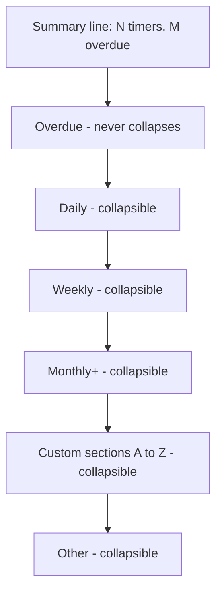
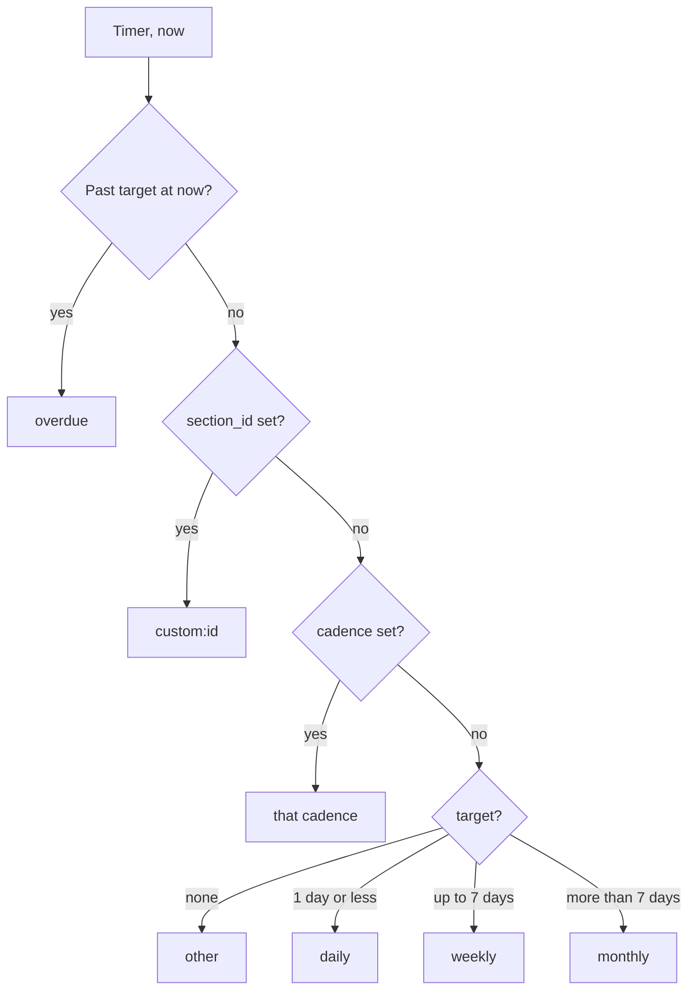
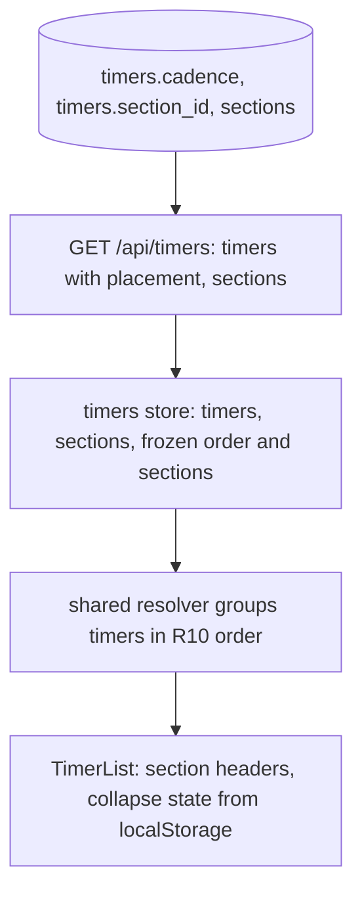

# Timer Sections - Plan

## Goal Capsule

- **Objective:** A user with many timers can scan the list fast and find a timer without reading every card, while overdue work stays visible at all times.
- **Means:** Group the list page into collapsible sections. A shared resolver picks each timer's section from its stored placement, its target, and the clock (KTD1, KTD2).
- **Product authority:** This Product Contract. The base app plan `docs/plans/2026-10-14-1946-feat-time-since-app-plan.md` stays authoritative for everything this plan does not change.
- **Open blockers:** None.
- **Stop conditions:** Stop and report when a requirement needs a new runtime dependency, or when the generated migration rebuilds the `timers` table in a way that can lose rows.
- **Execution profile:** Server, shared, and client code plus one migration. Six units: U1, U2, and U3 in order. Then U4 before U5. U6 can run any time after U3.
- **Product Contract preservation:** Changed: R15 added after document review, so a timer saved into a collapsed section stays visible. The rest is restructured with no scope change: the detail-page Scope bullet now says the detail page shows no section info while its edit form gains the picker. The diagram labels Overdue "never collapses" to match R8 and R11. The three Deferred-to-Planning questions are answered by KTD4, KTD5, and KTD7, so the Outstanding Questions section is removed.

---

## Product Contract

### Summary

The list page shows timers in collapsible sections instead of one flat list. Each timer goes into a cadence section (Daily, Weekly, Monthly+, Other) from its target, unless the user moves it to a different section, including sections the user creates. An Overdue section at the top holds every overdue timer, so a collapsed section never hides due work.

### Problem Frame

Today the list page is one flat list: overdue timers first, then the longest elapsed time first. With many timers, the user must read card after card to find one. The sort order mixes a daily chore next to a quarterly chore, so the position of a card says little about what kind of chore it is.

### Key Decisions

- **Auto placement with a user override.** New timers need no setup, and the user can still correct the app or use their own groups. Governs R1, R3, R4. (session-settled: user-directed — chosen over manual-only sections and fixed auto-only sections: zero setup cost, but the user keeps control)
- **Users can create their own sections, not only pick a cadence section.** Governs R4, R5. (session-settled: user-directed — chosen over overrides limited to the four cadence sections)
- **Overdue timers move to one pinned section at the top.** A collapse never hides due work. Governs R7, R8. (session-settled: user-directed — chosen over overdue timers staying in their home section with a count on the header, and over sections with no collapse)
- **The section order is fixed.** No drag to reorder, which keeps the UI small. Governs R10. (session-settled: user-directed — chosen over user-ordered sections)
- **Cadence thresholds come from the target.** Governs R2.

### Requirements

**Placement**

- R1. Each timer belongs to exactly one section at a time.
- R2. A timer with automatic placement goes into a cadence section by its target: Daily (target of 1 day or less), Weekly (more than 1 day, up to 7 days), Monthly+ (more than 7 days), or Other (no target).
- R3. When the user changes the target of a timer with automatic placement, the timer moves to the matching cadence section.
- R4. The user can move a timer to any section: a cadence section, a custom section, or back to automatic placement. A moved timer stays in its chosen section when its target changes.

**Custom sections**

- R5. The user can create a custom section with a name, rename it, and delete it.
- R6. When the user deletes a custom section, its timers go back to automatic placement. No timer is deleted.

**Overdue**

- R7. An overdue timer shows in the Overdue section at the top of the list, not in its home section.
- R8. The Overdue section cannot collapse.
- R9. When an overdue timer is reset, it goes back to its home section. The existing rule still applies: the card holds its position while its undo toast is open.

**List layout**

- R10. Sections show in this fixed order: Overdue, Daily, Weekly, Monthly+, custom sections A to Z, Other.
- R11. A section with no timers does not show on the list page.
- R12. Each section header shows the section name and its timer count.
- R13. The user can collapse and expand each section except Overdue. Each device remembers its own collapsed state.
- R14. Inside a section, timers keep the current sort: the longest elapsed time first.
- R15. When the user saves a timer into a collapsed section, that section opens.

### Acceptance Examples

- AE1. **Covers R2, R3.** Given "Water plants" has a 3-day target and automatic placement, it shows in Weekly. When the user changes the target to 1 day, it shows in Daily.
- AE2. **Covers R4.** Given the user moved "Water plants" to a custom section "House", when the user changes its target, it stays in House.
- AE3. **Covers R6.** Given "House" holds two timers, when the user deletes House, both timers show in their cadence sections and no timer is lost.
- AE4. **Covers R7, R8, R13.** Given the user collapsed Weekly, when a Weekly timer becomes overdue, it shows in the open Overdue section at the top.
- AE5. **Covers R9.** Given an overdue Daily timer, when the user resets it, the card stays in place while the undo toast is open, then moves to Daily.
- AE6. **Covers R11.** Given no timer has a target of more than 7 days, the list shows no Monthly+ header.

### Scope Boundaries

- No reorder of sections by the user.
- No nested sections, and no timer in more than one section (no tags).
- No push alert settings for each section.
- The timer detail page shows no section info. Only its edit form gains the section picker (KTD4).

### Sources / Research

- `src/client/views/TimerList.vue` renders today's flat list from `timers.sorted`.
- `src/client/stores/timers.ts` owns the overdue-first sort and the held position after a reset.
- `src/server/db/schema.ts` has no section or group concept on `timers` today.

---

## Planning Contract

### Key Technical Decisions

- KTD1. **One shared resolver decides the section of a timer.** A pure module in `src/shared/` maps a timer's placement, target, last reset, and `now` to a section key. The client groups with it. Server tests and client tests use the same function, so the cadence thresholds live in one place. Governs R1, R2, R3, R7.
- KTD2. **The server stores placement as two nullable columns on `timers`.** `cadence` holds a cadence override (`daily`, `weekly`, `monthly`, `other`). `section_id` points at a custom section with `ON DELETE SET NULL`. Both null means automatic placement. A placement write always sets both columns, so at most one is non-null. The FK rule gives R6 for free: SQLite already runs with `foreign_keys = ON` in `src/server/db/client.ts`. Governs R4, R6.
- KTD3. **Custom sections are a new `sections` table owned by a user.** Columns: id, user id (cascade on user delete), name, created at. Names follow `parseName` rules. Names are unique for each user, case-insensitive. Each user can have at most 20 sections, like `MAX_TIMERS`. Governs R5.
- KTD4. **The add and edit forms carry a "Section" picker.** Options: Automatic (default), the four cadence sections, the user's custom sections A to Z, and "New section…". "New section…" shows a name field. The parent view creates the section first, then saves the timer with the new section id. Governs R4, R5.
- KTD5. **The Settings page holds a "Sections" card for rename and delete.** It lists every custom section, empty ones included, so an empty section is still reachable (R11 hides it on the list page). Delete asks for confirmation and says the timers go back to automatic placement. Governs R5, R6.
- KTD6. **The list response carries the sections.** `GET /api/timers` adds `sections: { id, name }[]`. Each `TimerView` adds `placement`. No separate list endpoint for sections. The client keeps one fetch on focus, as today.
- KTD7. **The demo seed adds no sections.** The demo shows automatic placement, which needs no setup. Demo users can still create sections. The existing user cascade removes them at cleanup.
- KTD8. **The held position after a reset also holds the section.** When `hold()` freezes the order, the store also freezes each timer's section key. A reset overdue card stays in Overdue until every hold is released, then the list regroups. Governs R9.
- KTD9. **Collapsed state lives in `localStorage` under one key.** The value is a list of collapsed section keys. Reads and writes are wrapped in try/catch, like `src/client/theme.ts`. An unknown or stale key has no effect. Governs R13.

### High-Level Technical Design

Section resolution, which KTD1 owns. The prose in R2, R4, and R7 is authoritative.

Data flow from storage to screen.

### Assumptions

- `drizzle-kit generate` emits `ALTER TABLE ... ADD COLUMN` for the two nullable columns. If it emits a table rebuild instead, the Stop condition applies.
- A section created through "New section…" can stay empty when the timer save then fails. The Settings card can delete it, so no rollback is planned.

---

## Implementation Units

### U1. Shared section resolver

**Goal:** Map a timer to its section key, and group and order a timer list by section.

**Requirements:** R1, R2, R3, R4, R7, R10, R11, R14. KTD1.

**Dependencies:** None.

**Files:**
- Create `src/shared/sections.ts`
- Modify `src/shared/types.ts`
- Create `tests/server/sectionResolver.test.ts`

**Approach:**
1. Add a `Placement` type to `src/shared/types.ts`: automatic, a cadence, or a custom section id. Add `placement` to `TimerView`, a `SectionView` type, and `sections` to `TimerList`.
2. In `src/shared/sections.ts`, add the cadence thresholds with `DAY_MS` from `src/shared/limits.ts`, the cadence labels (Daily, Weekly, Monthly+, Other), a section-key function, and a grouping function.
3. The grouping function takes the sorted timers, the sections, `now`, and an optional frozen key map (KTD8). It returns non-empty groups in R10 order. Custom sections sort A to Z by name with `localeCompare`. A timer whose custom section id is unknown falls back to automatic placement.
4. Use `isPastTarget` from `src/shared/overdue.ts` for the overdue check, so the list and the summary line agree.

**Patterns to follow:** `src/shared/overdue.ts` and `src/shared/gaps.ts` for small pure shared modules. `tests/server/overdue.test.ts` for test style.

**Test scenarios:**
- A target of exactly 1 day resolves to daily. A target of 1 day plus 1 hour resolves to weekly.
- A target of exactly 7 days resolves to weekly. A target of 8 days resolves to monthly.
- No target resolves to other.
- Covers AE1. An automatic timer with a 3-day target resolves to weekly. The same timer with a 1-day target resolves to daily.
- Covers AE2. A custom placement wins over the target.
- A cadence override wins over the target.
- An overdue timer resolves to overdue, whatever its placement.
- A custom placement with an id that is not in the sections list falls back to the automatic cadence.
- Grouping orders groups as Overdue, Daily, Weekly, Monthly+, custom A to Z, Other.
- Covers AE6. Grouping leaves out empty groups.
- Inside a group, the input order is kept.
- With a frozen key map, a timer keeps its frozen key even when the clock says otherwise.

**Verification:** The resolver tests pass, and `npm run typecheck` passes with the new types.

### U2. Sections storage and API

**Goal:** Store custom sections and timer placement, and serve them through the timers API and a new sections API.

**Requirements:** R4, R5, R6. KTD2, KTD3, KTD6, KTD7.

**Dependencies:** U1.

**Files:**
- Modify `src/server/db/schema.ts`
- Create a migration under `src/server/db/migrations/` with `npm run db:generate`
- Modify `src/server/timers/service.ts`
- Modify `src/server/timers/routes.ts`
- Modify `src/server/timers/validation.ts`
- Create `src/server/sections/service.ts`
- Create `src/server/sections/routes.ts`
- Modify `src/server/app.ts`
- Modify `tests/server/timers.test.ts`
- Create `tests/server/sections.test.ts`
- Modify `tests/server/timersHelpers.ts` if a section helper is needed

**Approach:**
1. Add the `sections` table and the two `timers` columns per KTD2 and KTD3. Generate the migration and read the SQL before you keep it.
2. `toTimerView` adds `placement` from the two columns. `listTimers` returns the user's sections with the timers. The route adds `sections` to the list response.
3. `POST /api/timers` and `PATCH /api/timers/:id` accept an optional `placement`. A new parser checks its shape. A custom placement must name a section that the user owns, otherwise the answer is 422.
4. Add `POST /api/sections`, `PATCH /api/sections/:id`, and `DELETE /api/sections/:id`. Mount them at `/api/sections` with `requireUser` and the same per-user write limiter as the timers routes. A section of another user answers 404.
5. Enforce the name rules and the cap of 20 from KTD3 with 422 answers.

**Patterns to follow:** `src/server/timers/routes.ts` for the route shape, `ownedTimer`, the write limiter, and `invalid` / `notFound` helpers. `src/server/timers/validation.ts` for `Parsed<T>` parsers.

**Test scenarios:**
- Creating a section returns 201 with its id and name, and the list response then includes it.
- A duplicate name that differs only in case returns 422.
- The 21st section returns 422.
- An empty or too-long name returns 422.
- Renaming a section changes its name in the list response.
- Renaming or deleting another user's section returns 404.
- Patching a timer with a custom placement stores it, and the timer view reports it.
- Patching a timer with a custom placement for another user's section returns 422.
- Patching a timer with a cadence placement stores the cadence and clears any section id.
- Patching a timer back to automatic clears both columns.
- Covers AE3. Deleting a section sets its timers back to automatic placement, and the timers still exist.
- Changing only the target of a timer with a custom placement keeps the placement.
- Creating a timer with a placement stores it. Creating one without a placement gives automatic placement.
- Section writes count toward the per-user write limit.
- Deleting a user removes that user's sections.

**Verification:** Server tests pass. A fresh database and an existing database both migrate on start.

### U3. Store support for sections and grouping

**Goal:** Keep sections in the timers store, add section actions, and expose grouped timers that respect the held position.

**Requirements:** R1, R5, R9, R10. KTD1, KTD6, KTD8.

**Dependencies:** U1, U2.

**Files:**
- Modify `src/client/stores/timers.ts`
- Modify `tests/client/timersStore.test.ts`
- Modify `tests/client/helpers.ts`

**Approach:**
1. Store `sections` from each list response, and clear it in `clear()`.
2. Add `placement` to `TimerChanges`, and pass it through `createTimer` and `updateTimer`.
3. Add `createSection`, `renameSection`, and `deleteSection`. `createSection` appends the returned section to `sections`. `renameSection` replaces it in `sections`. After a delete, refetch the list so the moved timers show their new placement.
4. In `hold()`, freeze a map of section keys next to `frozenOrder`. Release it in the same places as `frozenOrder`.
5. Add a `grouped` computed that calls the U1 grouping function with `sorted`, `sections`, `now`, and the frozen map.
6. Give `timerView` in `tests/client/helpers.ts` an automatic placement default, and give `listRoute` a `sections` field.

**Patterns to follow:** The existing `hold` / `releaseHold` / `releaseAllHolds` trio and `fetchTimers` sequence guard in `src/client/stores/timers.ts`.

**Test scenarios:**
- A list response with sections fills `sections`, and `clear()` empties it.
- `grouped` puts timers in R10 order from mixed placements.
- Covers AE5. After a reset of an overdue timer, the timer stays in the overdue group while the hold is open, then moves to its home group after `releaseHold`.
- A focus refresh releases all holds and regroups.
- After `createSection` and then `updateTimer` with the new id, `grouped` shows the timer under the new custom section with no refetch.
- `deleteSection` calls the API, then refetches the list.
- `updateTimer` with a placement sends it in the PATCH body.

**Verification:** Store tests pass.

### U4. Sectioned list page with collapse

**Goal:** Render the list page as section groups with headers, counts, and collapse.

**Requirements:** R7, R8, R10, R11, R12, R13, R14, R15. KTD9.

**Dependencies:** U3.

**Files:**
- Modify `src/client/views/TimerList.vue`
- Create `src/client/components/SectionGroup.vue`
- Create `src/client/collapsed.ts`
- Modify `tests/client/TimerList.test.ts`
- Modify `tests/e2e/smoke.spec.ts`

**Approach:**
1. Replace the flat `ul` with one `SectionGroup` for each entry in `timers.grouped`. Keep the summary line, the empty state, the error states, and the Add timer button as they are.
2. `SectionGroup` renders a header with the name and the count (R12). For every section except Overdue, the header is a button with `aria-expanded` that toggles the group. The Overdue header is plain text.
3. `src/client/collapsed.ts` reads and writes the collapsed keys per KTD9. It also exposes an "expand this key" call that U5 uses for R15.
4. The cards inside a group keep today's props and events.
5. In the smoke test, add a check that a section header shows after a timer is created.

**Patterns to follow:** `src/client/theme.ts` for guarded `localStorage`. Existing card list markup and Tailwind tokens in `src/client/views/TimerList.vue`.

**Test scenarios:**
- Covers AE6. Timers with 1-day and 3-day targets show Daily and Weekly headers and no Monthly+ header.
- Each header shows the right count.
- Covers AE4. With Weekly collapsed, an overdue Weekly timer shows under the open Overdue header.
- The Overdue header has no collapse control.
- Collapsing a section hides its cards, and the state survives a remount.
- When `localStorage` throws, the list still renders with every section open.
- Inside a section, the timer with the oldest last reset comes first.
- A custom section shows between Monthly+ and Other with its name.

**Verification:** List tests and the smoke test pass. The page reads well in light and dark theme in the browser.

### U5. Section picker in the add and edit forms

**Goal:** Let the user pick a placement, or create a new section, when adding or editing a timer.

**Requirements:** R4, R5, R15. KTD4.

**Dependencies:** U3, and U4 for the expand call that R15 needs.

**Files:**
- Modify `src/client/components/TimerForm.vue`
- Modify `src/client/views/TimerList.vue`
- Modify `src/client/views/TimerDetail.vue`
- Modify `tests/client/TimerForm.test.ts`
- Modify `tests/client/TimerDetail.test.ts`

**Approach:**
1. `TimerForm` takes the sections and an initial placement. It renders a "Section" select per KTD4 and emits `placement` with the submit payload. For "New section…", it emits the new name instead of an id.
2. The form validates a new name with the same length rule as the timer name.
3. `TimerList` and `TimerDetail` create the section first when the payload has a new name, then save the timer with the returned id. A failure shows in the form's existing error slot.
4. After a successful save, expand the timer's resolved section key through the U4 collapse module (R15).

**Patterns to follow:** The existing target fieldset and `problem` validation in `src/client/components/TimerForm.vue`.

**Test scenarios:**
- The select defaults to Automatic for a new timer.
- The edit form preselects the timer's current placement.
- Picking Weekly emits a cadence placement.
- Picking a custom section emits its id.
- Picking "New section…" shows a name field, and an empty name shows a validation message.
- Covers AE2. Editing a timer in a custom section and changing only its target keeps the section in the PATCH body.
- On the list page, adding a timer with a new section calls the sections API, then the timers API with the new id.
- When the section create fails, the form stays open and shows the error.
- With Weekly collapsed, adding a timer with a 3-day target opens Weekly, and the new card shows.

**Verification:** Form and detail tests pass.

### U6. Sections card on the Settings page

**Goal:** Let the user rename and delete custom sections, empty ones included.

**Requirements:** R5, R6. KTD5.

**Dependencies:** U3.

**Files:**
- Modify `src/client/views/Settings.vue`
- Create `src/client/components/SectionsCard.vue`
- Modify `tests/client/Settings.test.ts`

**Approach:**
1. `SectionsCard` lists custom sections A to Z by name only. It loads the list through the store when the store is not ready, because the sections arrive with the timers list (KTD6).
2. Rename is an inline edit with Save and Cancel.
3. Delete opens `ConfirmDialog` with text that says the timers go back to automatic placement.
4. With no custom sections, the card says how to make one from the timer form.

**Patterns to follow:** The `card` fieldset layout in `src/client/views/Settings.vue`. `src/client/components/ConfirmDialog.vue` for the delete confirmation.

**Test scenarios:**
- The card lists sections A to Z by name, including an empty section.
- Renaming sends a PATCH and shows the new name.
- A rename error shows inline and keeps the old name.
- Covers AE3. Confirming delete calls the API, and the section leaves the card.
- Cancelling delete changes nothing.
- With no sections, the card shows the help text.

**Verification:** Settings tests pass.

---

## Verification Contract

| Check | Command | Applies to |
|---|---|---|
| Unit and API tests | `npm test` | U1 to U6 |
| Types | `npm run typecheck` | U1 to U6 |
| Lint | `npm run lint` | U1 to U6 |
| Build | `npm run build` | U1 to U6 |
| Smoke flow | `npm run test:e2e` | U4 |
| Migration | `npm run db:generate`, then read the new SQL | U2 |

---

## Definition of Done

- Every unit's test scenarios exist and pass.
- `npm test`, `npm run typecheck`, `npm run lint`, `npm run build`, and `npm run test:e2e` pass.
- The new migration adds the `sections` table and the two `timers` columns without a table rebuild that can lose rows.
- An existing database starts with every timer in automatic placement and the list grouped by cadence.
- Each acceptance example AE1 to AE6 is covered by a test.
- No dead code or abandoned attempts remain in the diff.
